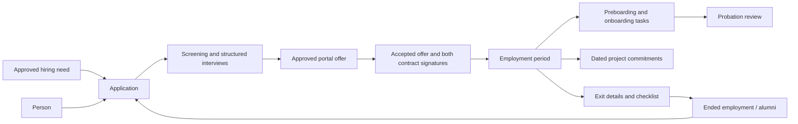

# HR implementation

## Work plan

- [x] Ground the current recruitment, portal, sales, and import flows in source.
- [x] Compare two model sketches and settle the command contract.
- [x] Rewrite undeployed HR migrations and implement transactional lifecycle commands.
- [x] Replace HR views with connected recruiting, people, journeys, and staffing workspaces.
- [x] Connect contextual AI, portal identities, contracts, and import callers.
- [x] Run migrations and lifecycle checks in isolated PostgreSQL, then verify the UI.

The existing HR PRD requires one talent record and human decisions. The current implementation mixes person identity with recruitment state and copies identity into employee rows. Source history contains one relevant commit and most current HR work is uncommitted; the review and current code are the available design evidence. Connected personal email and Drive sources are unrelated to this repository's implementation history, so this design uses local source, migrations, tests, and PRD evidence.

## Working rules

Preserve existing unrelated sales, operations, settings, brand, and account work. Each worker owns separate files. Verify the schema against an isolated local PostgreSQL instance before applying an upgrade. Keep deployed migration history intact and preserve existing records during the upgrade.

All consequential HR transitions use authenticated database commands. The database derives the actor from the session, validates permission and current state, and saves state and history in one transaction. Frontend forms show the same prerequisites and retain inputs after errors.

The normalized relationships are person identity, recruitment applications, and employment periods. Interviews and employment offers belong to an application. Onboarding, reviews, exits, and project assignments belong to an employment period. Portal accounts map explicitly to people. Salary and interview notes remain restricted to HR and authorized administrators.

## Synthesis

Candidate A is the base: explicit `hr_people` and `hr_applications` with a single transactional `hr_command` boundary. An independent cross-judge scored A 24/25 and B 23/25 for repeat journeys, safety, caller complexity, integration, and usable UX. Retain `employees` as employment periods and existing opportunities/interviews/offers/task/assignment names. Graft B's stable external import identity and independent onboarding/probation facts. Reject legacy person-wide stages and parallel compatibility tables because the undeployed schema can be rewritten directly.

## Shared implementation contract

Backend writes authoritative fields and the command union into `apps/admin/src/hr/domain.ts` first, then SQL and `data.ts`. Other workers consume this module and request changes through the parent.

- `hr_people`: id, full_name, email, phone, headline, location, skills, notes, source, owner_email, contact_allowed, version, timestamps. Identity lives here only. `hr_person_accounts` explicitly maps profile_id to person_id.
- `hr_applications`: id, person_id, opportunity_id, recruitment stage, status active/hired/rejected/withdrawn, reason, screening summary/recommendation, source/referrer, stage_entered_at, version, timestamps. Talent-only intake creates a person without an application. Applications require a requisition.
- `employees`: employment periods with id, person_id, application_id, accepted offer reference, role, manager_email, parrain, start_date, end_date, planned_exit_date, status preboarding/active/offboarding/ended, onboarding_completed_at, independent probation_status and probation_end, version, timestamps.
- `interviews` and `offers` use application_id. Offers have deterministic margin, separate approvals, and approved/shared/accepted/declined states. Sharing publishes an actual portal-visible offer. External delivery is explicitly manual or pending, never falsely successful.
- `onboarding_items` and `reviews` use employee_id. Tasks have required, assignee, due_date, dependency, evidence, completion timestamp. `offboarding_records` uses employee_id and preserves handover, exit interview, and rehire outcome. Checklists use completion timestamps.
- `employee_project_assignments` uses employment-period employee_id. Dated proposed/reserved/confirmed/active/completed/cancelled periods permit repeat assignments to one project. Capacity counts commitments at interval boundaries and locks the employment root. Removal retains history.
- `employee_salaries` uses employment-period employee_id. Non-overlapping dated intervals (start_date, nullable end_date) carry salary_monthly and one open interval is current; hiring seeds the first interval from the accepted offer, `save_salary` closes the previous open interval the day before a change, and exit closes history at the exit date. Staff-only projections see no salary rows.
- `hr_events`: person_id, optional application_id and employee_id, semantic kind, previous/next state, actor identity, rationale, request UUID, timestamp. `hr_command_receipts` makes identical retries idempotent and rejects changed payloads under the same key.
- Contracts retain account-owned candidate_id for portal/storage, with explicit person_id, application_id, optional employee_id. Keep candidate signatures and add `contract_countersignatures` for employer signatures. Hire checks both records.
- `hr_ai_suggestions`: target IDs, kind, payload, sources, input_version, model, status, review metadata. Save suggestions only after checking source versions and scope. Review accepted/dismissed is separate from applying facts.
- `my_applications`, `my_application_events`, `my_employment`, `my_onboarding_items`, and `my_offers` are explicit account-scoped safe projections. No email authorization and no confidential notes in portal views.
- Opportunities retain existing requisition fields and gain staffing project reference and version. Stable imports use `hr_person_external_ids`.

`loadWorkspace()` returns parsed arrays people, applications, employees, salaries, opportunities, interviews, offers, tasks, reviews, exits, exitItems, assignments, events, contracts, signatures, countersignatures, suggestions, projects, clients, accounts, plus capabilities. Prefer a single scoped `hr_workspace_snapshot()` RPC. `executeCommand(input)` validates a discriminated snake-case kind payload, adds request_id if absent, invokes `hr_command({command})`, and parses returned IDs/version. State changes carry expected_version. SQL raises descriptive permission, prerequisite, and stale-version errors and rolls back. `hr_application_requirements(application_id,to_stage)` supplies the UI and SQL with the same gates.

Required intents: create/update person, link account, create/move/dispose application, update screening, add note, schedule/complete/cancel interview, create/approve/share/respond offer, hire, start/complete onboarding, save/complete task, schedule/record review, open/save/complete exit, assign/end assignment, create/update/approve/publish requisition, countersign contract, save/review suggestion, and source-keyed import person. Import is an explicit attributed historical operation, never a normal hire bypass.

## Worker boundaries

- Backend owns HR migrations, affected HR view blocks in the Clerk identity migration, database types, hr/domain.ts, and hr/data.ts. Remove superseded HR, employee, source-extension, and assignment migrations. New HR migration follows auth/roles and projects. Preserve unrelated foundations.
- Workspace UI owns apps/admin/src/hr except domain.ts/data.ts/assist.ts and removes obsolete HR components once replaced. Export HrWorkspace with view overview/recruiting/people/journeys/staffing, actorEmail, and role. Preserve brand tokens and useful current UI patterns.
- Integrations owns portal/HrPortal.tsx, server/boondmanager.ts, api/hr-assist.ts, hr/assist.ts, and AI API authorization changes. Do not edit App.tsx, vite.config.ts, schema, or database types. Use the shared command/read contract.
- Parent owns App.tsx, SectionHeader.tsx, SpotlightSearch.tsx, Sales Opportunities callers, CSV import, Vite registration, tests, PostgreSQL bootstrap/verification, documentation, and final integration.


## Resulting lifecycle



HR and administrators can use the lifecycle workspace; requisition approval and exceptional offer margins require an administrator. Sales receives a staffing workspace with contact information, confidential notes, contracts, offers, and decision history omitted. Portal users see only applications, offers, employment, and tasks connected to their explicitly linked account. Linking uses a searchable account picker rather than matching email as authorization.

The lifecycle migration is `20261014090000_hr_lifecycle.sql`. The pipeline, employee and source-extension migrations were restored after the connected database was found to have applied them already. The upgrade preserves the old directory tables and views in the restricted `hr_legacy_20261014` schema, copies person identities and dated employment periods, and installs the new RPCs in one migration. It refuses an upgrade containing legacy requisitions, offers, interviews, contracts or other journey records until their relationships have a dedicated conversion. The existing sales rename repair safely skips fresh schemas that already use `sales_contacts`.

Interview invitations remain marked for manual delivery and offer sharing publishes the offer in the portal. The application does not claim that email or calendar integrations delivered a message. Contract PDFs are immutable and both signatures reference the exact document hash and accepted offer package.

AI drafts support interview preparation, onboarding plans, staffing suggestions, handover, and alumni reconnection. They carry authorized source IDs and versions, including project demand versions. Reviewing a draft and applying specific editable facts are separate actions. Source changes invalidate stale advice. AI does not hire, reject, approve compensation, or end employment.

Boond API and CSV imports share stable tenant/reference identities. Historical employment import requires administrator authority and actual source dates. Missing or contradictory dates preserve the person and add a review note rather than fabricate an employment period.

## Verification

Run `pnpm typecheck`, `pnpm test`, and `pnpm --filter @quicksort/admin build` for the application checks. `pnpm test:hr-db` checks every migration from scratch in an isolated Docker PostgreSQL 17 database and verifies the complete lifecycle and actual RLS grants. It needs a local container named `quicksort-hr-verification`; create it with:

```sh
docker run --name quicksort-hr-verification -e POSTGRES_PASSWORD=local-hr-check -d postgres:17
pnpm test:hr-db
```

The verifier creates and drops a unique test database each run. It uses no Supabase credentials and exports only generated test records to `/tmp/hr-ui-workspace.json` for browser verification. Tests cover two applications for one person, exact offer-linked double signatures, required task dependencies, independent probation, interval capacity, assignment history, complete exits, normal rehire, stable historical imports, permissions, transaction rollback, stale versions, retries, AI evidence freshness, and sanitized sales projections.

The same command also tests a populated legacy directory upgrade, including retained IDs, notes, dates, audit archives, candidate requests, Sales records, restricted archive access and the actual authenticated workspace RPC. Unsupported journey records reject the upgrade and roll back without altering the original schema.

It also runs simultaneous transactions in a second isolated database. It verifies that competing 60% and 50% assignments leave only the first commitment, and that simultaneous identical requests create one person and one history event.

Run `pnpm test:browser` for the workspace and portal flows. Component previews use the real UI and Supabase client with intercepted fixture requests. The public website preview runs on port 5183 with fixture credentials, so job-publication checks do not depend on a developer's running server or database configuration.

## Verified on October 4, 2026

- Workspace typecheck, all 29 unit tests, and the admin production build passed.
- Every migration applied from scratch. Lifecycle, permission, rollback, stale-version, retry, and concurrent-transaction checks passed.
- All 11 browser checks passed. These cover five HR views at desktop and mobile widths, reviewed intake, rehire history, failed-save input retention, staffing access, stale AI evidence, application selection, pre-hire contract review and download, employee-owned tasks, offer acceptance and decline, and job publication changes.
- Desktop and mobile screenshots were inspected. Browser API calls use fixtures; live model generation and external message delivery were not exercised.

The HR upgrade was applied to the connected project `ctgtowqjswbxwiapcvfj` on October 4, 2026. All 24 people were preserved. The 23 original employee records remain archived; dated employment periods were copied into the new model. One employee is missing a start date and has a review note on their person record. No date or portal-account link was invented. The migration notifies PostgREST to reload its schema cache.
