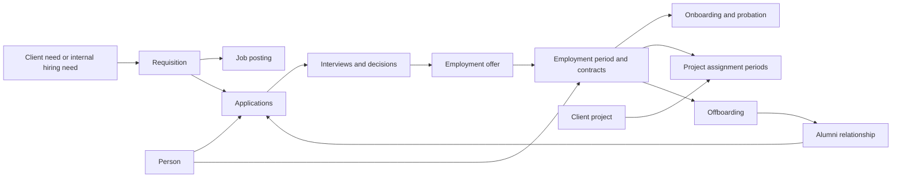

# HR lifecycle review

Baseline review date: 4 October 2026. The implementation that followed is recorded in [HR implementation](hr-implementation.md). References below describe the pre-rewrite working tree; several referenced files and migrations have since been replaced.

Scope: the current local working tree, including uncommitted HR changes and migrations. This document records findings and a proposed product direction. It does not change the application.

The application already has recruitment, interviews, offers, contracts, onboarding, probation, project assignments, offboarding, and alumni filters. The missing foundation is a reliable connection between those workflows. The existing [HR PRD](../apps/prd-hr.md) describes much of the intended lifecycle, but several requirements are represented by labels or manual checkboxes rather than enforced behavior.

## What the application currently supports

| Lifecycle step | Present today | Main gap |
| --- | --- | --- |
| Hiring need and job posting | Sales opportunities with hiring modes and approval states; separate public job posts | Requisition approval, public publication, and staffing demand are separate writes. HR lacks a connected requisition workspace. |
| Candidate intake | Manual entry, resume parsing, talent pool, recruitment board | One candidate has one opportunity and one stage. Repeat applications require overwriting history or duplicating the person. |
| Interviews | Scheduling records, HR and technical interviews, client presentations, scorecards | Scheduling creates a database record. Calendar invitations, panel permissions, and notification delivery are not implemented by that action. |
| Employment offer | Salary, daily cost, target daily rate, margin, approval states | Approval authority is not separated by role. Sending an offer changes a status without delivering an offer. |
| Contract and hire | Portal documents, typed candidate signature, candidate-to-employee conversion | Portal identities and pipeline identities differ. Hiring can bypass the accepted-offer and signed-contract checks. |
| Onboarding and probation | Default checklists, assignees, due dates, buddy, reviews | Identifier mismatch hides tasks and reviews. There is no normal progression through preboarding, onboarding, and probation. |
| Project assignment | Employee-to-project links with position, allocation, and dates | No capacity planning, overlap validation, repeat assignment periods, or assignment history after removal. |
| Offboarding | Exit dates, checklist, handover text, rehire flag | Opening an exit does not update employment state. Closing an exit does not close assignments or enforce a recorded handover. |
| Alumni | Employee status, directory filter, talent-pool filter | No rehire journey, relationship management, or new employment period. Some views read frozen candidate details. |
| AI assistance | Resume extraction and a separate CV evaluation workspace | Evaluations are not connected to the pipeline candidate or application. AI-labelled pipeline steps depend on manually recorded fields. |

## Findings to fix first

### P0: employee access policy is unrestricted for authenticated users

[The employee migration](../supabase/migrations/20261010090000_employees_table.sql#L39) creates a policy for every operation with `using (true) with check (true)` for `authenticated`. That policy does not distinguish a candidate, employee, HR operator, or administrator. Subject to table privileges, it permits access to all employee rows and modifications to them.

Replace the policy with explicit HR and manager scopes, plus an employee's own permitted fields. Verify denied reads and writes through the database with candidate, employee, HR, sales, and admin identities. I did not verify whether this local migration is deployed or what the live table grants are.

### P1: onboarding mixes employee IDs and candidate IDs

[Onboarding](../apps/admin/src/hr/Onboarding.tsx#L129) stores the selected employee ID in `onboarding_items.candidate_id`, although that foreign key references `pipeline_candidates`. Default plan creation uses the correct candidate ID, but the task list filters against `current.id` instead of `current.candidate_id`. Reviews have the same filtering error at line 334.

Result: default tasks and scheduled reviews disappear from the selected plan, and adding a custom task can fail its foreign-key check. Use the correct relationship consistently, then migrate these records to an employment-period relationship in the target model.

### P1: contracts and pipeline records use different identities

[Contracts](../supabase/migrations/20260906164638_workforce_platform.sql#L95) reference `profiles.id`. [Pipeline contract gates](../apps/admin/src/hr/gates.ts#L137) compare that identifier with `pipeline_candidates.id`. Resume intake creates a pipeline row independently, so the IDs do not normally match. The employee record uses the same comparison.

Introduce an explicit account-to-person relationship and link each contract to its employment or application. Also correct the "signed by both parties" gate: the current signature table stores one candidate signature per contract and does not model an employer countersignature.

### P1: hire, stage movement, and exit completion can partially save

[Hiring](../apps/admin/src/hr/CandidateRecord.tsx#L191) updates the candidate, inserts an employee, then inserts an event as separate requests. A failed employee insert leaves a hired candidate without an employee record. A retry can collide with the unique candidate relationship. [Stage movement](../apps/admin/src/hr/data.ts#L68) and [exit completion](../apps/admin/src/hr/Offboarding.tsx#L400) also split the business change from its history event.

Use transactional database commands with permission checks, prerequisites, an expected current state, and a retry key. Each command must either save the state and its event together or save nothing.

### P1: visible gates do not consistently enforce decisions

"Mark as hired" is available to an active candidate regardless of their stage. Its handler does not require an accepted offer or signed contract. The detailed gate checklist and `gateError` implement different rules, and past-stage checklists are rendered as completed even when evidence is missing.

Make one authoritative transition policy drive both the UI and database commands. Support an explicit, logged exception for historical imports and justified manual overrides. Missing evidence must remain visible after an override.

### P1: offer approval and delivery are overstated

[Offers](../apps/admin/src/hr/Offers.tsx#L107) takes an HR or Direction role from the selected button, rather than from the approver's permissions. The HR pipeline tables generally require `private.is_admin()`, which currently checks only the `admin` role, even though workspace roles include `hr` and `sales`.

"Send offer" only updates status and `sent_at`, despite the success message claiming delivery for signature. Separate draft, approved, delivery pending, delivered, accepted, declined, and expired states. Connect delivery to an actual integration, and show delivery failure with retry. Record each approval separately.

### P1: employment progression and exit handoffs are incomplete

The onboarding workflow can confirm probation directly, without requiring a held review or adding a lifecycle event. Normal actions do not progress employees into onboarding and probation. An exit opens a workflow without setting the employee's stage to offboarding. Exit completion checks task flags, but does not require the handover text or reconcile project assignments.

Define explicit commands for starting onboarding, completing onboarding, recording a probation decision, opening an exit, and completing an exit. Onboarding completion and probation are separate facts because they can overlap. Every command records its actor and evidence.

### P2: staffing is a link editor rather than a planning workflow

[Assignments](../supabase/migrations/20261013090000_employee_project_assignments.sql) allow one row per employee and project, with each allocation constrained independently to 1–100%. Two simultaneous assignments can therefore total 200%. The employee record deletes a removed assignment and allows assignment controls for alumni.

Keep dated assignment periods and distinguish proposed, reserved, confirmed, active, completed, and cancelled assignments. Validate concurrent capacity and employment dates. End or cancel an assignment while preserving its history. Allow a person to return to the same project later.

### P2: alumni and recruiting histories cannot represent a return

`pipeline_candidates.opportunity_id` supports only one recruitment process. `employees.candidate_id` is unique and the employee has one start date. That shape cannot preserve multiple applications and multiple employment periods for one person. Talent-pool search and display can also use frozen pre-hire details after employee edits. Completed offboarding names fall back to "Consultant" because the name lookup loads only current employees.

Preserve identity, applications, and employment periods separately. Alumni is a relationship view, not the end of the person's record.

### P2: activity notes can reset recruitment aging

[Stage dwell](../apps/admin/src/hr/stages.ts#L72) starts at the latest event, including a note that leaves the stage unchanged. A new note can make a long-stalled candidate look healthy.

Calculate aging from the actual transition into the current application stage. Track last contact and last activity as separate dates.

## Recommended product structure

Use a shared person record across recruiting, employment, and staffing. Keep each application's progress separate from employment state and project availability.

A person can have several applications, successive employment periods, and concurrent project assignments. An alumnus can apply again. An employee can be in probation and already working on a project. Availability is calculated from confirmed commitments and dates, rather than inferred from the recruitment column.

Retain existing records and identifiers during migration. Map portal accounts explicitly, move recruitment state onto applications, and link employment tasks and exits to employment periods. Keep salary, interview evidence, and exit notes scoped to the roles that need them.

The proposed HR navigation is:

| Area | Daily purpose |
| --- | --- |
| Overview | My actions, approvals, interviews today, upcoming arrivals, overdue tasks, probation deadlines, and departures. |
| Recruiting | Requisitions and applications with board, table, interviews, and offers views. |
| People | One searchable directory with candidates, employees, and alumni views. |
| Journeys | Onboarding and offboarding work queues, with owners, deadlines, dependencies, and evidence. |
| Staffing | Availability, project demand, proposed placements, allocation calendar, and upcoming mission endings. |

Keep contracts and documents on the person's record, with a shared document queue when useful. Expose the same staffing records through Sales projects. Put CV analysis on the relevant application rather than requiring a separate trip to an analyzer tab. Give every operational view a stable URL and preserve filters when users return.

The person record should show identity and contact details, owner, relationship status, availability, next action, and a chronological activity feed. Its sections cover profile and skills, applications, employment, projects, documents, and history. Compensation and restricted notes follow their own permissions.

Preserve the existing Quicksort design language. Modernize through clear action queues, searchable tables, inline editing, contextual drawers, and visible save states. Use a full record page for longer work. Distinguish "no evidence" from "evidence could not load"; auxiliary query failures currently become empty arrays that can misleadingly show pending gates.

## What to borrow from BoondManager

Boond connects candidate activity, recruiting Kanban, saved searches, contract simulation, and onboarding task lists. Borrow that continuity and its ability to work from a person's record. [Boond recruitment and HR](https://www.boondmanager.com/solutions/recrutement-et-rh).

Boond's availability documentation separates HR state from availability calculated using assignments, leave, and planned departures. That is a useful model for the staffing workspace. [Boond resource availability](https://help.boondmanager.com/fr/articles/727472-ressources-identifier-les-consultants-disponibles-ou-bientot-disponibles).

Boond also describes matching the meaning of client needs against available profiles. For this application, show the supporting evidence, missing information, availability, and constraints alongside each suggested match. [Boond AI matching](https://www.boondmanager.com/blog/ia-et-recrutement-comment-boond-accelere-votre-recherche-pour-vos-besoins-clients).

## Where AI belongs

AI should assist a business action in context. Parsing or matching is work performed within sourcing and screening, rather than a mandatory recruitment stage.

| Context | Proposed AI action | Reviewable result |
| --- | --- | --- |
| Hiring need | Draft a job description from an approved brief | Editable draft with requirements traced to the brief. |
| Intake | Extract and normalize skills and experience; suggest possible duplicates | Source-backed fields and a proposed merge. A person confirms identity. |
| Application | Explain fit to this requisition and prepare interview questions | Evidence, missing requirements, and questions. Unknown facts remain unknown. |
| Interview | Summarize approved notes and draft a scorecard | Interviewer reviews evidence and submits the final scorecard. |
| Offer | Draft the offer explanation | Amounts and margin come from deterministic calculations. Authorized people approve. |
| Onboarding | Propose a plan using role, start date, and first project | Named task owners, due dates, dependencies, and a diff before creation. |
| Staffing | Find suitable available consultants for a dated project need | Evidence, capacity, dates, and preferences. A manager confirms the placement. |
| Offboarding | Draft a handover from assigned projects and recorded responsibilities | Source-linked checklist and gaps for HR and the manager to review. |
| Alumni | Find relevant former colleagues and draft a reconnection message | Rehire context and contact preferences. A person reviews outreach before sending. |

Store an AI suggestion separately from approved facts, with its target record, source references, model, generation time, input version, and review outcome. Mark suggestions stale when their source changes. Apply the user's permissions before retrieving evidence. Treat resumes and notes as data, never as instructions to the assistant. Hiring, rejection, compensation, and exit decisions remain human decisions.

Start with interview preparation, evidence-backed profile summaries, and onboarding task drafts. Staffing matching becomes valuable once skills and capacity are reliable. Measure accepted suggestions, corrections, preparation time, and saved administrative work.

## Delivery order and completion criteria

1. **Repair existing handoffs and access.** Correct onboarding identifiers and contract identity mapping. Restrict employee access. Make hire and exit commands atomic. Verify denied access, failed-write rollback, retry behavior, visible tasks, and linked signatures.
2. **Represent repeat journeys.** Introduce people, applications, and employment periods. Verify two simultaneous applications and an alumni rehire with both employment histories intact.
3. **Make daily operations connected.** Add the overview queue and navigable journeys. Implement real offer delivery and calendar scheduling, with visible failures and retry. Verify a complete recruitment-to-onboarding journey.
4. **Complete staffing and exits.** Add dated capacity planning, roll-off alerts, retained assignment history, and assignment closure at exit. Verify overlapping allocations, partial availability, repeat project periods, and a completed exit.
5. **Embed AI assistance.** Connect evaluations to applications and ship the first contextual actions. Verify sources, stale suggestions, permissions, corrections, and human approval.

Track application-stage aging, time to interview, offer acceptance, day-one readiness, overdue onboarding work, probation decisions due, bench capacity, upcoming mission endings, offboarding completion, and alumni rehire. Compute these from events, dates, and allocations rather than manually entered AI scores.

## Verification and limits

`pnpm --filter @quicksort/admin typecheck` passed. `pnpm test` passed all 16 unit tests. Existing browser tests cover job administration and the portal, but do not establish the employee lifecycle behavior described above. One unit-test diagnostic also notes that private photo file-serving checks need the deployment checkout.

Computer-use access was restored after the first attempt. I inspected the live workspace shell, but repeated active-tab changes prevented a stable HR walkthrough. Findings above come from source and migrations, not completed browser interactions. No production records, deployed policies, emails, interviews, offers, or employee decisions were changed.
